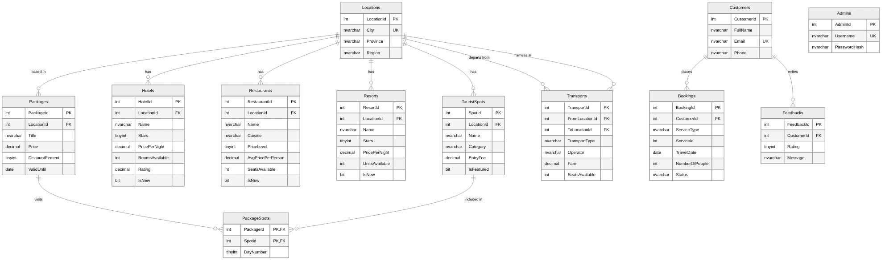

# Karnel Travel Guide – Database Design

**Database:** KarnelTravelDB · **DBMS:** Microsoft SQL Server 2019+ · **Access:** Entity Framework Core

The database has 12 tables. Every place a customer can visit or book (tourist spot, hotel, restaurant, resort, package, transport route) belongs to a **Location**. This is what lets the Search page filter by location.

## 1. Entity–Relationship Diagram

## 2. Tables and the pages that use them

| Table | Purpose | Used by |
| --- | --- | --- |
| Locations | Cities / provinces in Viet Nam | Search filters, every information page |
| TouristSpots | Beaches, monuments, mountains, temples… | Tourist Spots page, Search, Home (featured) |
| Hotels | Hotels with stars, price, rooms available | Hotel Information, Search, Information (new) |
| Restaurants | Restaurants with cuisine, price level, seats | Restaurant Information, Search, Information (new) |
| Resorts | Resorts with stars, price, units available | Resorts Information, Search, Information (new) |
| Transports | Routes between two locations, by bus/train/car/plane/boat | Travel Information |
| Packages | Tours and discounts | Home, Information (packages and discounts) |
| PackageSpots | Which spots a package visits, on which day | Package detail |
| Customers | People who booked or sent feedback (no login) | Contact Us, Admin |
| Bookings | Orders from Contact Us | Contact Us, Admin |
| Feedbacks | Feedback from Contact Us | Contact Us, Admin |
| Admins | Staff accounts for the admin area | Admin login |

## 3. Relationships

| Parent | Child | Type | Rule |
| --- | --- | --- | --- |
| Locations | TouristSpots, Hotels, Restaurants, Resorts, Packages | 1 – many | A location cannot be deleted while places refer to it |
| Locations | Transports (FromLocationId, ToLocationId) | 1 – many (twice) | From and To must be different |
| Packages ↔ TouristSpots | PackageSpots | many – many | Deleting a package or spot removes its links |
| Customers | Bookings | 1 – many | |
| Customers | Feedbacks | 1 – many | |

**Bookings.ServiceType + ServiceId** point to one row in Hotels, Restaurants, Resorts, Transports or Packages, depending on the type. A single foreign key cannot cover five tables, so the application checks that the row exists before saving (Algorithms, A5).

## 4. How the search criteria map to columns

| Criterion in the assignment | Tourist spots | Hotels | Restaurants | Resorts |
| --- | --- | --- | --- | --- |
| Type | Category | – | Cuisine | – |
| Location | LocationId | LocationId | LocationId | LocationId |
| Price | EntryFee | PricePerNight | AvgPricePerPerson | PricePerNight |
| Quality | – | Stars, Rating | PriceLevel, Rating | Stars, Rating |
| Quantity | – | RoomsAvailable ≥ rooms wanted | SeatsAvailable ≥ people | UnitsAvailable ≥ units wanted |
| Availability | – | RoomsAvailable > 0 | SeatsAvailable > 0 | UnitsAvailable > 0 |

## 5. Data dictionary

### Locations

| Column | Type | Null | Key / rule |
| --- | --- | --- | --- |
| LocationId | INT | No | PK; identity |
| City | NVARCHAR(100) | No |  |
| Province | NVARCHAR(100) | No |  |
| Region | NVARCHAR(20) | No | check: Region IN ('North', 'Central', 'South') |
| Description | NVARCHAR(500) | Yes |  |

Table rules: UNIQUE (City)

### TouristSpots

| Column | Type | Null | Key / rule |
| --- | --- | --- | --- |
| SpotId | INT | No | PK; identity |
| LocationId | INT | No | FK → Locations.LocationId |
| Name | NVARCHAR(150) | No |  |
| Category | NVARCHAR(30) | No | check: Category IN ('Beach', 'Monument', 'Mountain', 'Nature', 'Temple', 'Cultural', 'Island') |
| Description | NVARCHAR(1000) | Yes |  |
| Address | NVARCHAR(250) | Yes |  |
| EntryFee | DECIMAL(12,0) | No | default 0; check: EntryFee >= 0 |
| BestTime | NVARCHAR(100) | Yes |  |
| ImageUrl | NVARCHAR(250) | Yes |  |
| IsFeatured | BIT | No | default 0 |
| CreatedAt | DATETIME2 | No | default SYSDATETIME() |

### Hotels

| Column | Type | Null | Key / rule |
| --- | --- | --- | --- |
| HotelId | INT | No | PK; identity |
| LocationId | INT | No | FK → Locations.LocationId |
| Name | NVARCHAR(150) | No |  |
| Stars | TINYINT | No | check: Stars BETWEEN 1 AND 5 |
| Address | NVARCHAR(250) | Yes |  |
| Phone | NVARCHAR(20) | Yes |  |
| PricePerNight | DECIMAL(12,0) | No | check: PricePerNight > 0 |
| TotalRooms | INT | No | check: TotalRooms > 0 |
| RoomsAvailable | INT | No |  |
| Rating | DECIMAL(2,1) | Yes | check: Rating BETWEEN 0 AND 5 |
| Description | NVARCHAR(1000) | Yes |  |
| ImageUrl | NVARCHAR(250) | Yes |  |
| IsNew | BIT | No | default 0 |
| CreatedAt | DATETIME2 | No | default SYSDATETIME() |

Table rules: CHECK (RoomsAvailable BETWEEN 0 AND TotalRooms)

### Restaurants

| Column | Type | Null | Key / rule |
| --- | --- | --- | --- |
| RestaurantId | INT | No | PK; identity |
| LocationId | INT | No | FK → Locations.LocationId |
| Name | NVARCHAR(150) | No |  |
| Cuisine | NVARCHAR(50) | No |  |
| Address | NVARCHAR(250) | Yes |  |
| Phone | NVARCHAR(20) | Yes |  |
| PriceLevel | TINYINT | No | check: PriceLevel BETWEEN 1 AND 4 |
| AvgPricePerPerson | DECIMAL(12,0) | No | check: AvgPricePerPerson > 0 |
| TotalSeats | INT | No | check: TotalSeats > 0 |
| SeatsAvailable | INT | No |  |
| Rating | DECIMAL(2,1) | Yes | check: Rating BETWEEN 0 AND 5 |
| OpenHours | NVARCHAR(50) | Yes |  |
| Description | NVARCHAR(1000) | Yes |  |
| ImageUrl | NVARCHAR(250) | Yes |  |
| IsNew | BIT | No | default 0 |
| CreatedAt | DATETIME2 | No | default SYSDATETIME() |

Table rules: CHECK (SeatsAvailable BETWEEN 0 AND TotalSeats)

### Resorts

| Column | Type | Null | Key / rule |
| --- | --- | --- | --- |
| ResortId | INT | No | PK; identity |
| LocationId | INT | No | FK → Locations.LocationId |
| Name | NVARCHAR(150) | No |  |
| Stars | TINYINT | No | check: Stars BETWEEN 1 AND 5 |
| Address | NVARCHAR(250) | Yes |  |
| Phone | NVARCHAR(20) | Yes |  |
| PricePerNight | DECIMAL(12,0) | No | check: PricePerNight > 0 |
| TotalUnits | INT | No | check: TotalUnits > 0 |
| UnitsAvailable | INT | No |  |
| Rating | DECIMAL(2,1) | Yes | check: Rating BETWEEN 0 AND 5 |
| Facilities | NVARCHAR(300) | Yes |  |
| Description | NVARCHAR(1000) | Yes |  |
| ImageUrl | NVARCHAR(250) | Yes |  |
| IsNew | BIT | No | default 0 |
| CreatedAt | DATETIME2 | No | default SYSDATETIME() |

Table rules: CHECK (UnitsAvailable BETWEEN 0 AND TotalUnits)

### Transports

| Column | Type | Null | Key / rule |
| --- | --- | --- | --- |
| TransportId | INT | No | PK; identity |
| FromLocationId | INT | No | FK → Locations.LocationId |
| ToLocationId | INT | No | FK → Locations.LocationId |
| TransportType | NVARCHAR(20) | No | check: TransportType IN ('Bus', 'Train', 'Car', 'Plane', 'Boat') |
| Operator | NVARCHAR(100) | No |  |
| Fare | DECIMAL(12,0) | No | check: Fare > 0 |
| DurationHours | DECIMAL(4,1) | No | check: DurationHours > 0 |
| DepartureTimes | NVARCHAR(150) | Yes |  |
| SeatsAvailable | INT | No | check: SeatsAvailable >= 0 |
| Description | NVARCHAR(500) | Yes |  |

Table rules: CHECK (FromLocationId <> ToLocationId)

### Packages

| Column | Type | Null | Key / rule |
| --- | --- | --- | --- |
| PackageId | INT | No | PK; identity |
| LocationId | INT | No | FK → Locations.LocationId |
| Title | NVARCHAR(150) | No |  |
| Description | NVARCHAR(1000) | Yes |  |
| DurationDays | TINYINT | No | check: DurationDays BETWEEN 1 AND 30 |
| Price | DECIMAL(12,0) | No | check: Price > 0 |
| DiscountPercent | TINYINT | No | default 0; check: DiscountPercent BETWEEN 0 AND 90 |
| ValidFrom | DATE | No |  |
| ValidUntil | DATE | No |  |
| ImageUrl | NVARCHAR(250) | Yes |  |
| IsActive | BIT | No | default 1 |

Table rules: CHECK (ValidUntil >= ValidFrom)

### PackageSpots

| Column | Type | Null | Key / rule |
| --- | --- | --- | --- |
| PackageId | INT | No | FK → Packages.PackageId; cascade delete |
| SpotId | INT | No | FK → TouristSpots.SpotId; cascade delete |
| DayNumber | TINYINT | No | default 1 |

Table rules: PRIMARY KEY (PackageId, SpotId)

### Customers

| Column | Type | Null | Key / rule |
| --- | --- | --- | --- |
| CustomerId | INT | No | PK; identity |
| FullName | NVARCHAR(100) | No |  |
| Email | NVARCHAR(150) | No |  |
| Phone | NVARCHAR(20) | No |  |
| CreatedAt | DATETIME2 | No | default SYSDATETIME() |

Table rules: UNIQUE (Email)

### Bookings

| Column | Type | Null | Key / rule |
| --- | --- | --- | --- |
| BookingId | INT | No | PK; identity |
| CustomerId | INT | No | FK → Customers.CustomerId |
| ServiceType | NVARCHAR(20) | No | check: ServiceType IN ('Hotel', 'Restaurant', 'Resort', 'Transport', 'Package') |
| ServiceId | INT | No |  |
| TravelDate | DATE | No |  |
| NumberOfPeople | INT | No | check: NumberOfPeople BETWEEN 1 AND 50 |
| Quantity | INT | No | default 1; check: Quantity BETWEEN 1 AND 50 |
| Note | NVARCHAR(500) | Yes |  |
| Status | NVARCHAR(20) | No | default 'New'; check: Status IN ('New', 'Contacted', 'Completed', 'Cancelled') |
| CreatedAt | DATETIME2 | No | default SYSDATETIME() |

### Feedbacks

| Column | Type | Null | Key / rule |
| --- | --- | --- | --- |
| FeedbackId | INT | No | PK; identity |
| CustomerId | INT | No | FK → Customers.CustomerId |
| Rating | TINYINT | No | check: Rating BETWEEN 1 AND 5 |
| Subject | NVARCHAR(150) | Yes |  |
| Message | NVARCHAR(2000) | No |  |
| IsRead | BIT | No | default 0 |
| CreatedAt | DATETIME2 | No | default SYSDATETIME() |

### Admins

| Column | Type | Null | Key / rule |
| --- | --- | --- | --- |
| AdminId | INT | No | PK; identity |
| Username | NVARCHAR(50) | No | unique |
| PasswordHash | NVARCHAR(256) | No |  |
| FullName | NVARCHAR(100) | No |  |
| LastLoginAt | DATETIME2 | Yes |  |
| CreatedAt | DATETIME2 | No | default SYSDATETIME() |
## 6. Sample data

`02_seed_data.sql` loads 10 locations, 20 tourist spots, 12 hotels, 12 restaurants, 8 resorts, 14 transport routes, 5 packages, 5 customers, 5 bookings, 3 feedbacks and 1 admin account. Places are real destinations in Viet Nam. Prices, ratings and room counts are illustrative sample values.

**Demo admin login:** `admin` / `Admin@123`. The password is stored as an ASP.NET Core `PasswordHasher` hash.

## 7. Images to collect

Each row stores an `ImageUrl` such as `/images/hotels/rex-saigon.jpg`. Put the photos in the project's `wwwroot/images/` folder using exactly these names. Use photos you are allowed to use, such as your own, or free-licence photos from Unsplash, Pexels or Wikimedia Commons.

| Folder | Files |
| --- | --- |
| images/spots/ (20) | hoan-kiem-lake.jpg, temple-of-literature.jpg, ho-chi-minh-mausoleum.jpg, ha-long-bay.jpg, fansipan.jpg, cat-cat-village.jpg, hue-imperial-city.jpg, thien-mu-pagoda.jpg, my-khe-beach.jpg, ba-na-hills.jpg, marble-mountains.jpg, hoi-an-ancient-town.jpg, an-bang-beach.jpg, nha-trang-beach.jpg, po-nagar-towers.jpg, xuan-huong-lake.jpg, valley-of-love.jpg, independence-palace.jpg, cu-chi-tunnels.jpg, sao-beach.jpg |
| images/hotels/ (12) | metropole-hanoi.jpg, old-quarter-garden.jpg, novotel-ha-long.jpg, de-la-coupole.jpg, sapa-valley-view.jpg, silk-path-hue.jpg, novotel-danang.jpg, my-khe-ocean-breeze.jpg, royal-hoi-an.jpg, sheraton-nha-trang.jpg, dalat-palace.jpg, rex-saigon.jpg |
| images/restaurants/ (12) | cha-ca-thang-long.jpg, bun-cha-huong-lien.jpg, hong-hanh.jpg, quan-hanh.jpg, be-man.jpg, madame-lan.jpg, morning-glory.jpg, lac-canh.jpg, le-rabelais.jpg, cuc-gach-quan.jpg, pizza-4ps.jpg, xin-chao.jpg |
| images/resorts/ (8) | topas-ecolodge.jpg, pilgrimage-village.jpg, intercontinental-danang.jpg, nam-hai.jpg, six-senses-ninh-van.jpg, vinpearl-nha-trang.jpg, ana-mandara-dalat.jpg, jw-marriott-phu-quoc.jpg |
| images/packages/ (5) | ha-long-cruise.jpg, sapa-trekking.jpg, central-heritage.jpg, dalat-escape.jpg, phu-quoc-break.jpg |
